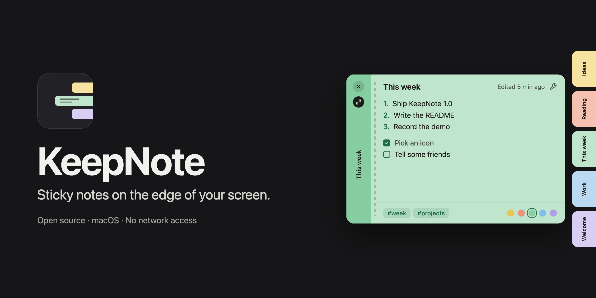
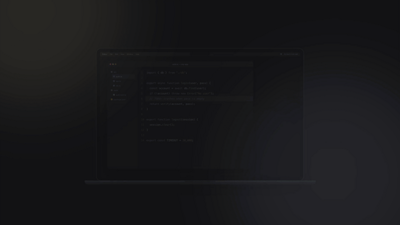

<p align="right"><a href="README.md">English</a></p>



<p align="center"><a href="https://colletpedro.github.io/keepnote/pt-br/"><br>Assista ao vídeo completo</a></p>

# KeepNote

Notas adesivas para macOS que ficam esperando como uma fileira de abas coloridas na borda direita da tela: leve o cursor até lá, escolha uma nota, escreva, e ela volta a sair do caminho.

**[Baixar KeepNote.dmg](https://github.com/colletpedro/keepnote/releases/latest/download/KeepNote.dmg)**

Requer um Mac com chip Apple (M1 ou mais novo) e macOS 13 ou mais recente. O download é feito só para chips Apple.

## Instalação

**1. Abra o download e arraste o KeepNote para Aplicativos.**

**2. Abra o KeepNote em Aplicativos.** O macOS vai avisar que não foi possível verificar o app. Clique em **OK** (ou **Concluído**). É esperado; [o motivo está abaixo](#por-que-o-macos-mostra-um-aviso).

**3. Permita uma vez.** Abra **Ajustes do Sistema → Privacidade e Segurança**, role até **Segurança**, clique em **Abrir Mesmo Assim** ao lado do KeepNote e confirme. O macOS não pergunta de novo para esta cópia do app. (No macOS 13 e 14 também dá para clicar no app com a tecla Control e escolher **Abrir**.)

## Atualizações

O KeepNote não verifica atualizações sozinho, porque não tem acesso à rede. As versões novas saem [no site](https://colletpedro.github.io/keepnote/pt-br/) e na [página de releases](https://github.com/colletpedro/keepnote/releases). **Ajustes → Sobre → Buscar atualizações…** abre o site no navegador.

## Por que o macOS mostra um aviso?

O KeepNote não é notarizado pela Apple. A notarização exige uma assinatura paga do Apple Developer (US$ 99 por ano), e o KeepNote é um projeto gratuito e de código aberto, então por enquanto ele é distribuído sem ela. O macOS mostra esse aviso para todo app que não passou por esse processo. Ele diz que a Apple não verificou o app, não que há algo errado com ele. Estas são as quatro coisas que você mesmo pode conferir:

1. **Dá para ler e compilar.** Todo o código-fonte está neste repositório, sem bibliotecas de terceiros. `./Scripts/build.sh` compila o mesmo app a partir dele.
2. **Ele não consegue usar a rede.** O KeepNote roda no sandbox do macOS sem os entitlements de rede, então o sistema recusa qualquer conexão que ele tentasse fazer. Confira: `codesign -d --entitlements - /Applications/KeepNote.app` não lista acesso à rede.
3. **Ele só alcança o que você der.** Fora do próprio contêiner, o sandbox deixa o KeepNote abrir apenas as pastas e os arquivos que você escolher, para sync, importação e exportação. O texto das suas notas é cifrado no disco com uma chave que fica no Keychain deste Mac.
4. **Dá para conferir o download.** Cada versão traz um arquivo `KeepNote.dmg.sha256`. `shasum -a 256 KeepNote.dmg` deve imprimir o mesmo valor.

## O que ele faz

- **Uma pilha na borda da tela.** As notas são abas na borda direita, ou na esquerda (Ajustes → Pilha → Borda da tela): a pilha inteira, as espiadas e as notas ancoradas se espelham para sair em direção ao meio da tela, e um Dock de qualquer lado fica livre. Passar o cursor pela borda abre as abas em leque, cada uma com sua cor e seu rótulo; a pilha rola quando há muitas. Tocar numa aba mostra uma espiada da nota sem tirar o foco do app em que você está; clicar abre a nota para edição.
- **Ancorada ou solta.** Uma nota aberta fica ancorada à pilha e fecha quando você clica em outro lugar. **Flutuar nota** (⌥⌘P) a descola da borda para ela ficar na tela, redimensionável, e lembra a posição; arrastar uma nota flutuante de volta até a borda da pilha a devolve (**Voltar à pilha**).
- **Markdown enquanto você escreve.** Negrito, itálico, tachado, destaque, links, títulos, listas com marcador, numeradas e checklists (com recuo e renumeração automática), citações, código, tabelas e divisores, tudo com atalho e no menu Ferramentas dentro da nota.
- **Cores e tags.** Cinco cores de papel, trocáveis a qualquer momento, e `#tags` com sugestões enquanto você digita. A janela Todas as notas filtra por tag e busca no título, nas tags e no texto.
- **Editar em Todas as notas.** A nota selecionada em Todas as notas abre no painel com tudo o que uma nota tem — título, texto, listas e checklists, os atalhos da nota, Ferramentas, busca (⌘F), as cores, as tags, Fixar no centro e Manter na pilha — e é salva sozinha. Uma nota aberta no painel e numa janela ao mesmo tempo é uma nota só: o que você digita num lugar aparece no outro na hora, e nada se perde. Notas e dailies arquivadas podem ser editadas ali e continuam arquivadas; uma nota que não pôde ser decifrada aparece somente leitura, com o motivo. Selecionar uma nota conta como abri-la para a regra de arquivamento. **Nova nota** cria a nota no próprio painel, com o cursor no título — com a tag da lista numa tag, como a daily de hoje em Daily. A lista se ordena por **Editada**, **Criada** ou **Título** (a escolha fica guardada); ↑ e ↓ passam por ela, Return leva ao texto da nota, Esc volta. **Abrir** tira a nota como nota solta, e um botão da barra de ferramentas esconde a barra lateral e a lista para a nota ocupar a janela.
- **Notas daily.** Dê a uma nota a tag `daily`, ou use **Daily de hoje** (⌥⌘Y, ou o botão de calendário na pilha). A pilha mantém as dailies dos seus dois dias mais recentes; as mais antigas são arquivadas e ficam em **Daily**, em Todas as notas, agrupadas por dia. Você pode definir um modelo para as novas notas daily (Ajustes → Daily → **Editar modelo da Daily…**). As **tarefas pendentes** (Ajustes → Daily → **Tarefas pendentes da última daily**) passam adiante: ao criar uma daily nova, os itens de checklist que ficaram sem marcar nas dailies do último dia anterior podem ser oferecidos no topo dela (*Perguntar sempre*, o padrão), entrar direto com a opção de desfazer (*Trazer automaticamente*) ou ficar onde estão (*Não trazer*). Eles entram no fim da daily nova, com os subitens recuados, abaixo do dia de onde vieram ("De quinta-feira, 15/10"), sem repetir o que o modelo já tem; a daily anterior nunca muda.
- **Fixar, manter e arquivar por tempo.** *Fixar no centro* prende até cinco notas no meio da pilha, sempre inteiras. *Manter na pilha* livra uma nota do arquivamento. Notas que você não abre há 7, 14 ou 30 dias (você escolhe em Ajustes → Pilha → **Arquivar notas não abertas há**; 14 por padrão) vão sozinhas para Arquivadas, nunca são apagadas; nos dois últimos dias aparece um relógio na aba. Fixar, manter e as regras de arquivamento não mudam a data *Editada* da nota, que só muda quando você altera o texto ou o título.
- **Backups.** Uma vez por dia o KeepNote copia o banco para uma pasta `Backups` ao lado dele, cifrada exatamente como o original, e guarda as sete cópias mais recentes; também faz uma antes de uma atualização mudar o jeito de guardar as notas. Ajustes → Geral → **Backups** mostra quando foi feito o último, com **Fazer backup agora** e **Restaurar…**, que lista os backups com a data e o número de notas, pede confirmação, faz um backup das suas notas como estão agora e reabre o KeepNote com o escolhido. Nada sai do Mac.
- **Arquivadas e desfazer.** As notas arquivadas têm janela própria. Apagar uma nota dá 10 segundos (ajustável em Ajustes → Notas → **Desfazer uma exclusão por**) para desfazer.
- **Imagens e arquivos.** Arraste uma imagem do Finder ou do navegador para a nota, cole uma (inclusive uma captura de tela) ou use **Inserir imagem…** em Ferramentas: ela fica no texto, na largura da nota, com cantos arredondados. Outros arquivos — arrastados, colados ou com **Anexar arquivo…** — aparecem como um cartão com ícone, nome e tamanho. Um clique seleciona a imagem e abre o arquivo no app dele; Espaço mostra os dois na Visualização rápida; o botão direito tem Abrir, Salvar como…, Remover e, numa imagem, **Editar descrição…**, que é o que o VoiceOver lê. Cada anexo pode ter até 25 MB. Eles ficam no banco, cifrados como o texto, uma vez só por mais notas que tenham o mesmo arquivo, e vão embora com as notas que os tinham. A espiada mostra a primeira imagem da nota, Todas as notas marca com um clipe as notas com anexos, e os links mostram a mãozinha e "⌘-clique para abrir".
- **Sincronização por pasta.** Opcionalmente (Ajustes → Sincronização), o KeepNote grava um arquivo de texto `.hmnote` por nota numa pasta que você escolhe (o iCloud Drive é sugerido). Os anexos vão junto como cópias comuns na pasta `Attachments` dela. O provedor da pasta leva os arquivos entre os Macs; o KeepNote não tem servidor próprio.
- **Importar e exportar.** Exporte as notas em Markdown ou texto simples, um arquivo por nota ou um só documento, ou num arquivo KeepNote (`.hmnotearchive`) que preserva cores, estados e datas. Imagens e arquivos vão junto, numa pasta `Attachments` que o texto exportado referencia (dentro do arquivo KeepNote, que vira um pacote). A importação lê esse arquivo ou uma pasta de arquivos `.hmnote`.
- **Onde ele fica.** Na barra de menus, e no Dock só enquanto uma das janelas dele está aberta. **Abrir ao iniciar sessão** e **Mostrar sobre apps em tela cheia** (Ajustes → Geral) são opcionais. O idioma do app se escolhe em Ajustes → Geral → **Idioma**.

## Compilar a partir do código

Basta o Command Line Tools da Apple (`xcode-select --install`) ou o Xcode. O KeepNote não tem dependências além dos frameworks do sistema.

```bash
git clone https://github.com/colletpedro/keepnote.git
cd keepnote
./Scripts/build.sh --run
```

Isso compila o app em `build/` e o abre. Num clone novo não há certificado de assinatura, então o build é assinado **ad-hoc** e mostra um aviso visível. A assinatura ad-hoc muda a cada build, então depois de cada recompilação o macOS volta a pedir acesso ao item do Keychain com a chave que cifra as notas; escolha Permitir, nenhuma nota se perde.

Para acabar com esses pedidos, assine com um certificado que tenha **Team ID**: um certificado **Apple Development**, que o Xcode cria para qualquer Apple ID, de graça (Xcode → Ajustes → Contas → Gerenciar Certificados → +). O build o encontra e usa sozinho. Para um app assim, o Keychain guarda a permissão da chave por time, então toda build é o mesmo app para ele. Um certificado autoassinado (**KeepNote Dev**: Acesso às Chaves, **Assistente de Certificado → Criar um Certificado…**, **Raiz Autoassinada**, **Assinatura de Código**) mantém a assinatura estável, mas não tem Team ID, e o Keychain volta a pedir depois de cada recompilação. Outro certificado funciona com `KEEPNOTE_SIGN_ID="Nome"`.

| Comando | O que faz |
|---|---|
| `./Scripts/build.sh` | build de debug em `build/` |
| `./Scripts/build.sh --release` | build otimizado |
| `./Scripts/build.sh --install` | build de release, substitui `/Applications/KeepNote.app` (recusa um build ad-hoc, a menos que `KEEPNOTE_ALLOW_ADHOC=1`) |
| `./Scripts/release.sh` | release arm64 assinado com `KEEPNOTE_SIGN_ID`, empacotado em `dist/KeepNote.dmg` com o `.sha256` |
| `./Scripts/test.sh` | as suítes de teste; usam bancos temporários e nunca tocam nas suas notas |

`KEEPNOTE_SDK=/caminho/para/MacOSX.sdk` substitui o SDK que o build escolhe.

## Atalhos

Estes são os padrões. Todos os atalhos abaixo, menos Fechar, podem ser trocados em Ajustes → Atalhos: clique no atalho e pressione a nova combinação, que precisa de ⌘, ⌥ ou ⌃. Esc cancela, Delete deixa o comando sem atalho, e **Restaurar padrões** traz estes de volta. Uma combinação que outro comando do KeepNote já usa, ou que o sistema recusa porque outro app a tem, não é aceita; o campo diz o motivo. Seus atalhos ficam guardados neste Mac, e os menus, as dicas e a janela de boas-vindas mostram sempre os atuais. Os atalhos de formatação são fixos.

| Globais, de qualquer app | O que faz |
|---|---|
| `⌥⌘N` | Nova nota |
| `⌥⌘A` | Todas as notas |
| `⌥⌘E` | Arquivadas |
| `⌥⌘Y` | Daily de hoje |
| `⌃⌥⌘D` | Focar a pilha (setas, Return, Espaço, Esc) |

| Numa nota | O que faz |
|---|---|
| `esc` / `⌘W` | Fechar |
| `⌘F` | Buscar na nota |
| `⌘G` / `⇧⌘G` | Próxima / anterior ocorrência |
| `⌥⌘C` / `⇧⌥⌘C` | Próxima / anterior cor |
| `⌥⌘P` | Flutuar nota / Voltar à pilha |
| `⇧⌘E` | Arquivar / trazer de volta |
| `⇧⌘⌫` | Apagar (com desfazer) |
| `⌘↩` | Marcar ou desmarcar a tarefa |
| `⇥` / `⇧⇥` | Recuar / voltar um nível num item de lista |
| `Espaço` | Visualização rápida da imagem ou do arquivo selecionado |

| Em Todas as notas | O que faz |
|---|---|
| `↑` / `↓` | Nota anterior / seguinte na lista |
| `↩` | Para o texto da nota selecionada |
| `esc` | Da nota de volta para a lista |

| Formatação | O que faz |
|---|---|
| `⌘B` `⌘I` `⇧⌘X` | Negrito, itálico, tachado |
| `⇧⌘H` | Destaque |
| `⌘E` | Código em linha |
| `⌘K` | Link |
| `⌥⌘1` `⌥⌘2` `⌥⌘3` | Título 1, 2, 3 |
| `⇧⌘7` `⇧⌘9` `⇧⌘L` | Lista com marcador, lista numerada, checklist |
| `⇧⌘B` | Citação |
| `⌥⌘K` | Bloco de código |
| `⌥⌘T` `⌥⌘R` | Tabela, divisor |
| `⇧⌘D` | Data de hoje |

## Acessibilidade

- **VoiceOver.** A faixa em repouso é um botão que abre a pilha. Cada aba é lida com o título da nota e depois a cor e os estados (fixada, mantida na pilha, flutuando, daily, arquiva em N dias), na ordem em que as abas aparecem; o menu de ações (VO-Shift-M) tem os comandos do clique direito. Todo controle só com ícone numa nota tem rótulo e dica, os itens de checklist são caixas que o VoiceOver marca, as tags têm a ação *Remover tag* e as amostras de cor dizem qual está escolhida. O KeepNote anuncia o que muda longe do cursor: nota criada, arquivada, apagada (o aviso então recebe o teclado, e o Desfazer fica a um passo), fixada, flutuando ou de volta à pilha, tarefas trazidas para a daily e notas arquivadas pela regra de tempo.
- **Teclado.** **Focar a pilha** (`⌃⌥⌘D`, configurável) dá o teclado à pilha: as setas ou Tab passam pelas abas e pelos botões, Espaço mostra a espiada, Return abre, Esc devolve o teclado. `⌘↩` marca a tarefa em que está o cursor. Em Todas as notas, ↑ e ↓ passam pela lista, Return leva à nota selecionada e Esc volta. Com Ajustes do Sistema → Teclado → *Navegação pelo teclado* ligada, Tab alcança todos os botões das notas, de Todas as notas e dos Ajustes, com um anel de foco na tinta da nota que aparece sobre todas as cores de papel. Todo atalho global e de dentro da nota pode ser gravado de novo em Ajustes → Atalhos.
- **Tela.** *Aumentar contraste* reforça contornos, a perfuração e o texto secundário; *Reduzir transparência* deixa a faixa, os chips e os avisos sólidos; *Reduzir movimento* troca o movimento da pilha e das notas por esmaecimentos. Ajustes → Geral → **Tamanho do texto** (de Pequeno a Extragrande) ajusta o texto das notas, da espiada e de Todas as notas. O texto tem contraste de pelo menos 4,5:1 sobre todas as cores de papel, com e sem Aumentar contraste, e nenhum estado é mostrado só pela cor.

## Privacidade

O KeepNote não faz nenhuma conexão de rede. Não tem servidor, conta, telemetria nem analytics, e os entitlements dele (`Resources/KeepNote.entitlements`) são o sandbox, as pastas que você escolhe e os bookmarks delas, nada mais. Um link dentro de uma nota abre no seu navegador.

O texto das suas notas é cifrado no banco local (AES-GCM) com uma chave guardada no Keychain deste Mac, que nunca sai dele e não é sincronizada. Imagens e arquivos anexados às notas são cifrados do mesmo jeito. Títulos e tags ficam sem cifra no banco para poderem ser buscados; os arquivos `.hmnote` do sync são texto simples, então continuam legíveis sem o app e ficam protegidos pelo que protege a pasta.

O banco fica em `~/Library/Containers/com.keepnote.KeepNote/Data/Library/Application Support/KeepNote/notes.sqlite`, e os backups dele na pasta `Backups` ao lado; são cópias do banco, com o texto cifrado do mesmo jeito.

## Desinstalar

Primeiro saia do KeepNote (ícone da barra de menus → Encerrar KeepNote). Se **Abrir ao iniciar sessão** estiver ligado, desligue em Ajustes → Geral antes de apagar o app. Depois remova cada item:

| O quê | Onde | Como remover |
|---|---|---|
| O app | `/Applications/KeepNote.app` | Mova para o Lixo. |
| Banco (suas notas) | `~/Library/Containers/com.keepnote.KeepNote/Data/Library/Application Support/KeepNote/notes.sqlite`, com `notes.sqlite-wal` e `notes.sqlite-shm` ao lado | Apague o container inteiro, `~/Library/Containers/com.keepnote.KeepNote`. No Finder: Ir → Ir para a Pasta…, digite `~/Library/Containers` e mova a pasta chamada **KeepNote** para o Lixo. |
| Backups (cópias das suas notas) | `~/Library/Containers/com.keepnote.KeepNote/Data/Library/Application Support/KeepNote/Backups`, até sete arquivos `notes-….sqlite` | Vão junto com o container acima. Para apagar só os backups, mova a pasta `Backups` para o Lixo. |
| Preferências | `~/Library/Containers/com.keepnote.KeepNote/Data/Library/Preferences/com.keepnote.KeepNote.plist` | Vai junto com o container acima. |
| Chave de criptografia | Keychain de login, item de senha com serviço `com.keepnote.KeepNote.bodykey`, conta `default` | Acesso às Chaves: busque `com.keepnote.KeepNote.bodykey` e apague. Ou no Terminal: `security delete-generic-password -s com.keepnote.KeepNote.bodykey` |
| Item de login | O próprio KeepNote, registrado no macOS (`SMAppService`) quando Abrir ao iniciar sessão está ligado | Desligue Abrir ao iniciar sessão antes de apagar o app. Se o app já foi apagado: Ajustes do Sistema → Geral → Itens de Início (Itens de Início e Extensões no macOS 15 em diante), selecione KeepNote em Abrir ao Iniciar Sessão e clique em −. |

A chave só serve para abrir aquele banco e os backups dele; remova tudo junto. Sem o container, suas notas e os backups vão embora com ele, então exporte antes (Ajustes → Sobre → Exportar todas as notas…) se quiser guardá-las.

**A pasta de sync é sua.** O KeepNote nunca a apaga, e desinstalar deixa a pasta, os arquivos `.hmnote` e `.hmtemplate` e a pasta `Attachments` exatamente onde estão. Apague você mesmo se não quiser mais.

## Licença

MIT. Veja [LICENSE](LICENSE).
